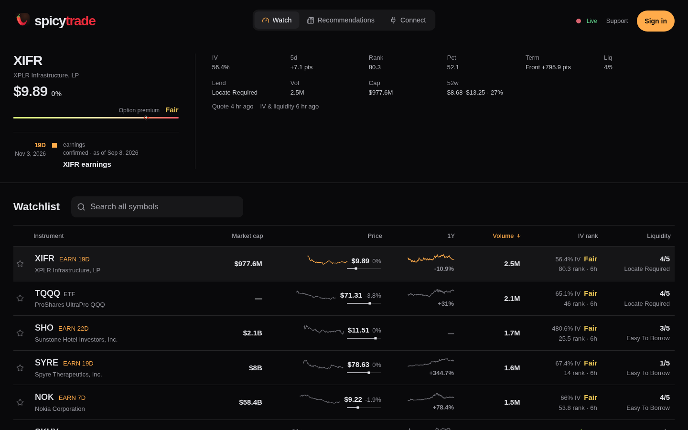

# spicytrade

**An options co-pilot your own AI agent can drive.** Orders go through your own tastytrade account and are limited to defined-risk trades, and your long-lived broker credential never leaves your machine.

Live at [spicy.trade](https://spicy.trade/watch).



## What it does

- **Watch** ([/watch](https://spicy.trade/watch)): a public market table for a tracked watchlist of US equities and ETFs, with quotes, implied-volatility metrics (IV rank and percentile, term structure), liquidity and a catalyst calendar, plus one symbol's detail. It needs no account.
- **Favorites**: signed-in members pin their own symbols.
- **Daily brief** ([/recommendations](https://spicy.trade/recommendations)): an options brief with an archive. It is written automatically by an AI model in a separate private workflow and is not personal advice.
- **MCP tools** at `https://spicy.trade/mcp`: any agent can connect with no credential for the public tier (snapshot quotes, catalysts, research reads and the brief). A signed-in member's agent also gets account reads and guarded order placement through their own tastytrade connection.
- **Local `spicytrade` CLI**: the connector that runs on your machine. It keeps your broker credential in the OS keyring and exchanges it for a short-lived token per request.

## How orders stay safe

Every check runs on the server and outranks whatever the model suggests:

- **Exact contract resolution** from the live option chain, never a contract taken from the model's text.
- **Defined risk only**: an order is admitted only if it is a debit opening trade or a close of a position verified in your account. Naked short exposure is refused.
- **Market guard**: the limit price is checked against the current bid and ask, and against the tick size the broker requires.
- **Broker dry-run**: tastytrade's own dry-run must come back clean before anything is submitted. That is also the buying-power check.
- **No automatic retries on ambiguity**: if a submission's or replacement's outcome is uncertain, nothing is retried and the account is blocked from further orders until it is reconciled against order history.
- **No server-held broker credential**: the Worker keeps its own tastytrade credential for market data only. Account paths require the caller's credential and never fall back to it.

spicytrade has no confirmation step of its own; any prompt before an order comes from the agent you run. These checks limit mistakes; they do not make a trade sound. See [risk disclosures](https://spicy.trade/disclosures).

## Quickstart for agent users

Use the market data and research with no install: point your MCP client at `https://spicy.trade/mcp`.

To connect your tastytrade account (Linux, Node.js 22+, `secret-tool` for the keyring):

```sh
curl -fsSL https://spicy.trade/install.sh | bash
```

That installs one file into `~/.local/share/spicytrade`, links `~/.local/bin/spicytrade`, then runs `spicytrade setup`, which asks before connecting your brokerage. Run it again to update. For agent-driven onboarding (the current agent registers itself), use `bash -s -- --connector-only` and follow the [connect guide](https://spicy.trade/connect/guide). Agents can read [llms.txt](https://spicy.trade/llms.txt) for the full map.

## Architecture

- Cloudflare Workers app built with TanStack Start and React, D1 for storage.
- `src/domain/`: pure schemas and logic. `src/server/`: Cloudflare and provider code. `src/routes/api.*`: thin HTTP adapters. `src/data/`: browser persistence. `src/components/`: product screens. `migrations/`: D1 schema.
- `ops/`: the member's own machine, i.e. the `spicytrade` CLI, built by `tools/build-agent.mjs` and installed by `public/install.sh`.
- Market data comes from tastytrade. Every account read goes through a `BrokerAdapter`; adding a brokerage is an adapter file plus its id.
- See [AGENTS.md](AGENTS.md) for the rules the code follows.

```sh
npm install
npm run dev        # http://localhost:3000
npm test && npm run lint && npm run build
```

## Disclaimer

spicytrade is software run by an individual. It is not a broker-dealer or registered investment adviser, and nothing it shows, including the daily brief, is investment advice. Options are risky and can expire worthless. Data and AI output can be wrong. Read the [risk disclosures](https://spicy.trade/disclosures). Not affiliated with or endorsed by tastytrade.

## License

[MIT](LICENSE)
